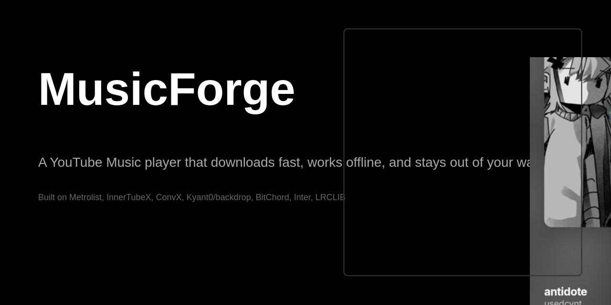
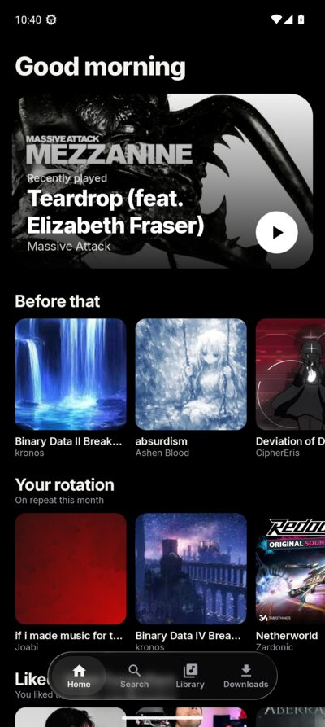
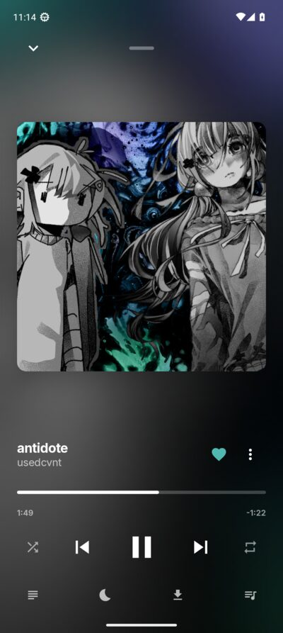
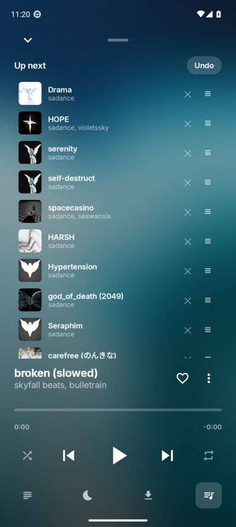
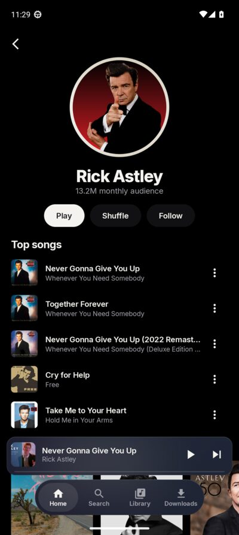

  

  
  
  
  
  
  

<h1 align="center">YouTube Music, forged for offline.</h1>

  <em>Your music. Your downloads. Fewer things getting in the way.</em>

  

MusicForge is an open-source Android music player built around a fairly simple idea: **your music app should still be useful when the internet isn't.** It brings YouTube Music discovery and playback together with persistent downloads, a library that stays yours, and an interface that tries to feel considered rather than crowded.

It's still a work in progress. The current development phase is **Sonata**, version **0.14 preview** ([latest release](../../releases/latest)). From 0.14 preview 1, every release is signed with one permanent key (a one-time reinstall is required when upgrading from older builds). The app's real name is still waiting for its dramatic reveal. For now, the codenames are part of the fun.

## A quick look

  
  
  
  

## The idea behind it

I wanted a YouTube Music player that downloaded quickly, worked offline, and didn't turn Home into an endless pile of recommendations I never asked for. So I started building one.

The project is tested on an Honor X7b with a Snapdragon 680. Not a mythical flagship living in a benchmark chart: an ordinary phone with ordinary limits. That makes performance, battery, and restraint actual design constraints instead of things to promise in a marketing paragraph.

A few rules guide the project:

- **Offline is a real mode.** Your downloaded music, local search, and play-history-based Home shouldn't disappear just because your connection does.
- **Your library should be portable.** Backups and exported files matter. You shouldn't have to ask an app for permission to keep your own music files.
- **The interface should earn its pixels.** Dark, monochrome foundations, expressive artwork, and a little liquid-glass polish where it makes sense. No animation is worth making the player stutter.
- **Reliability beats a feature checklist.** A download that resumes correctly is more valuable than five shiny buttons that don't.
- **Build on good open-source work, and give credit.** MusicForge has its own direction, but it doesn't pretend to have invented every useful idea or library it uses.

## What it can do

<strong>A Home screen with a reason for existing</strong>

Shelves use what you actually play: recent listening, time-of-day habits, repeat favourites, and liked songs that have slipped your mind. Each shelf should have a reason to be there. Long-press something that isn't your thing to say so.

On a clean install, Home starts with a welcome instead of pretending to know you. Sign in to bring in YouTube Music's feed and library.

<strong>Downloads that don't crawl</strong>

Large requests can get painfully slow, so MusicForge transfers audio in **4 MB ranges** rather than relying on one enormous request. In the recorded test, a 73 MB stream transferred about **5.6× faster** this way. The measurements and setup are documented in [BENCHMARKS.md](docs/BENCHMARKS.md).

Downloads are managed persistently, survive the app being killed, and can resume a partially completed transfer from its last chunk. Your music shouldn't have to start its entire life over because Android cleaned up.

<strong>Sign in when you want to</strong>

You can browse, search, and play without an account. Sign in with Google when you want your liked songs, playlists, albums, artists, and history to sync with YouTube Music. Searches can use your signed-in account too, and that behaviour can be switched off in Settings.

<strong>Offline means offline</strong>

Downloaded tracks start in about **0.3 seconds** in the recorded test, even without a signal. Search can find your own music, and Home can keep using your local play history. Airplane mode is not supposed to turn a music player into an expensive icon.

<strong>Bring your library with you</strong>

MusicForge can restore backups from Metrolist and ConvX. It imports supported library data and settings, carries over sign-in data from a backup when present, keeps downloads it already has, and offers to fetch missing tracks again.

<strong>Your files aren't held hostage</strong>

Finished downloads can be exported to `Music/MusicForge` as tagged Ogg files with artwork and lyrics. Use the Downloads screen for individual tracks or **Save all to Music** for the library, with background progress and cancellation. Those files can live on your phone or move to another player or computer.

<strong>The music-player essentials</strong>

Synced lyrics through LRCLIB, radio from a song or album, a sleep timer, a five-band equalizer, loudness levelling to −14 LUFS, Android Auto, a home-screen widget, ListenBrainz scrobbling, and listening stats.

<strong>Small details that make a difference</strong>

Swipe the mini player to skip. Swipe queue items away and undo the mistake. Paste a YouTube link into search. Artwork colours the player, and the liquid-glass treatment is kept to the navigation bar and mini player so the interface can look interesting without making a modest phone work overtime.

## Numbers, not vibes

These are measurements from the Honor X7b test device, not universal promises for every phone.

| Test | Recorded result |
|---|---:|
| Cold start | ~0.5 s |
| Tap to sound while streaming | ~1.3 s |
| Late frames while scrolling 6,000+ songs | 0.16% |
| APK size | ~5.4 MB |

See [BENCHMARKS.md](docs/BENCHMARKS.md) for more about the download measurements.

## Bugs taught us things

Some of the best engineering decisions started with something breaking in a very specific, very annoying way:

- **The language that worked in the emulator failed on the phone.** The device used `en-ZA`, while the emulator used `en-US`. YouTube rejects unsupported language tags with HTTP 400, so `YouTubeSession.youTubeLanguage()` now needs to use YouTube's own supported list.
- **A big download suddenly became dial-up.** Single requests above roughly 10 MB could crawl. Range-based 4 MB transfers are the workaround; the benchmark notes explain the observed results.
- **Old library artwork had gone missing.** Some restored artist and playlist images now return 404. `ArtRepair` re-fetches them when Coil reports the image error.
- **The Home screen was drawing covers too many times.** Removing an unnecessary window background and avoiding a second artwork pass reduced overdraw.
- **The last song didn't always count as a play.** The upstream playback event could be written only on a transition. MusicForge records the event when the play threshold is crossed and checkpoints progress every 30 seconds.

The point isn't that bugs are fun. The point is to fix the actual cause, add a guard against the same class of failure, and leave the next person a useful explanation.

## FAQ

<strong>Do I need a Google account?</strong>

No. Anonymous browsing, search, and playback are available. Sign in only for the features that need your YouTube Music library or account history.

<strong>Where are downloads stored?</strong>

Media3's `DownloadManager` keeps downloads in the app's private cache with a persistent index. Finished tracks can be exported from the Downloads screen to `Music/MusicForge` as tagged Ogg files.

<strong>Can I move over from Metrolist or ConvX?</strong>

Yes. Select a supported backup file. MusicForge imports available songs, artists, playlists, liked status, settings, and sign-in data. Existing downloads are kept; missing ones can be downloaded again.

<strong>Can I keep the music I download?</strong>

Yes. Export tracks as Ogg files with Vorbis comments, cover art, and embedded lyrics. **Save all to Music** can export the whole library as a background job with progress and a Cancel action.

<strong>Why APK instead of the Play Store?</strong>

This project is distributed through GitHub Releases. YouTube Music clients aren't permitted on Google Play, so installation is manual. On some Huawei/Honor and Xiaomi devices, you may also need to allow background activity so the system doesn't stop playback.

<strong>Is this an official Google or YouTube app?</strong>

No. MusicForge is an independent open-source project. It talks to YouTube Music through the InnerTubeX module; it doesn't run a MusicForge proxy server. Your Google cookie is stored on your device. Review the code and permissions for yourself, as you should with any app you install.

<strong>Why all the musical codenames?</strong>

Releases get names like Rondo and Sonata while the project finds its eventual name. The codename appears in the version name; the Android application ID remains `dev.musicforge.app`, so a codename change doesn't itself require a new app identity.

## What's next?

**Sonata (phase 14, 0.14.0)** is the current development phase. Its direction includes two-way listening-history sync, a redesigned full-bleed player with lyrics and queue panes, output-device controls, mood and genre discovery, a dedicated Explore tab, and better multi-select for collections. Treat this as the plan for the phase, not a claim that every item is already shipped.

Later ideas include crossfade, a final app name and 1.0, and whatever proves worth building next. Crossfade is deliberately deferred: two decoders have a real cost on lower-powered devices, and adding a feature just because it looks good in a checklist isn't the point.

## Want to help?

Start with [CONTRIBUTING.md](CONTRIBUTING.md) and [AGENTS.md](AGENTS.md). The standard build gate is `scripts/check.sh`: debug build, unit tests, and lint with zero lint errors. CI runs the same checks for code changes; documentation-only changes don't need an Android build.

Keep changes focused, work on a branch or in a separate worktree, and prefer a small tested fix over a grand rewrite. If you're using an AI coding agent, make sure it reads the project instructions and verifies the code instead of confidently inventing architecture. Computers already do enough of that on their own.

## Built with help from good projects

MusicForge is licensed under **GPL-3.0** and builds on open-source work. Please give the upstream projects their due:

- [Metrolist](https://github.com/MetrolistGroup/Metrolist) — YouTube Music API module, download design, and account sync
- [InnerTubeX](https://github.com/MetrolistGroup/innertubex) — stream extraction
- [ConvX](https://github.com/cosmictaserdev-creator/Convx) — screens, features, and backup format
- [Kyant0/backdrop](https://github.com/Kyant0/backdrop) — liquid-glass effects (Apache-2.0)
- [BitChord](https://github.com/kushagrasinghx/BitChord) — chunked transfers and monochrome visual inspiration
- [Inter](https://rsms.me/inter/) — typeface
- [LRCLIB](https://lrclib.net) — lyrics

MusicForge is not affiliated with Google or YouTube.

---

*Made because music should be easy to keep, easy to play, and a little more yours. The bugs are a work in progress too.*
