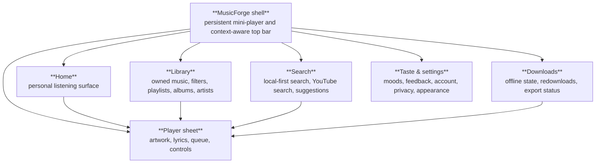
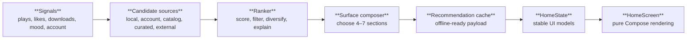

# MusicForge Personalized UI & Recommendation Specification

**Status:** Proposed implementation spec  
**Target build:** Nocturne / phase 10+  
**Scope:** New visual identity, Home and Library redesign, personalized recommendations, recommendation controls, adaptive layouts, and the code plan to implement them safely in MusicForge.

## 1. Product direction

MusicForge should feel like **a private listening instrument**, not a generic YouTube Music browser.

The redesign must answer three questions immediately:

1. **What should I play now?** — based on the listener's real history, library, downloads, mood, time, and current queue.
2. **What is mine?** — likes, playlists, recent listening, downloads, unfinished tracks, and personal patterns should outrank generic catalog content.
3. **What can I change?** — every recommendation surface must expose a reason and a lightweight control: play, hide, less like this, snooze, save, or change the mood.

### Non-negotiable product rules

- Never invent album art, album names, artists, or recommendation cards.
- Never show a generic “recommended albums” shelf when there are no eligible real candidates.
- Every recommendation item carries provenance: `LOCAL_LIBRARY`, `YOUTUBE_ACCOUNT`, `YOUTUBE_CATALOG`, `MOOD_CURATED`, or `EXTERNAL_SIGNAL`.
- Every personalized section has a reason, even if the reason is short: “Because you played Portishead this week”, “From Downloads”, “For late nights”, or “New from artists you follow”.
- A remote failure must fall back to real local content or a useful empty state, never to fake content.
- Personalization is local-first. Account data and external services are optional inputs, not requirements for a useful Home.
- The first-run experience asks for intent instead of pretending to know the listener.
- Personalization can be paused, reset, inspected, and corrected.
- The design must remain fast on the Honor X7b: no live blur behind scrolling content, no full-size artwork decode for list rows, and no ranking query on the main thread.

## 2. Research conclusions

### What to borrow

| Source | Borrow | Do not copy blindly |
|---|---|---|
| ConvX | Cupertino-style controls, sheets, strong now-playing focus, synced lyrics, adaptive feature breadth | Full Liquid Glass as the default; ConvX itself warns its stable build is outdated and its live-glass approach is risky on weaker renderers |
| Metrolist | Account/library synchronization, Material 3 discipline, quick picks, downloads, library management, import compatibility | Its maintenance-mode posture and generic feed as the primary identity |
| BitChord | Monochrome restraint, artwork-driven color, strong typography, fast bounded transfers, focused player | A direct Apple Music imitation or a second large multi-platform architecture |
| Spotify current controls | Taste profile, “less like this”, hide/snooze, smart filters, mood/genre steering, visible recommendation controls | Remote black-box personalization and commercial ranking assumptions |
| Android Compose guidance | Stable lazy-list keys, content types, deferred state reads, release-only performance measurement, baseline profiles | Premature abstraction or composing the entire feed as one giant item |

### Sources checked

- [ConvX](https://github.com/cosmictaserdev-creator/Convx)
- [Metrolist](https://github.com/MetrolistGroup/Metrolist)
- [BitChord](https://github.com/kushagrasinghx/BitChord)
- [Jetpack Compose performance](https://developer.android.com/develop/ui/compose/performance)
- [Compose lazy lists and grids](https://developer.android.com/develop/ui/compose/lists)
- [Spotify: Understanding recommendations](https://www.spotify.com/safetyandprivacy/understanding-recommendations/)
- [Spotify: New user controls](https://newsroom.spotify.com/2025-09-05/new-user-controls-personalize-listening/)

## 3. New visual identity

Working name: **Nocturne / Signal**. This is a design-system codename, not necessarily the final app name.

The current monochrome/artwork idea remains, but it becomes a more intentional visual system instead of a collection of glass surfaces.

### Design principles

1. **One memorable surface:** the Home hero and player use the current track's artwork as a restrained color field.
2. **Quiet structure:** most content sits on a flat canvas with spacing and typography doing the hierarchy work; cards are used for meaningful grouping, not every row.
3. **Personal evidence:** section headings and reasons make the app feel observant without becoming noisy.
4. **Editorial rhythm:** Home alternates between one large anchor, compact rows, and occasional grids; it should not be an endless wall of identical cards.
5. **Physical but controlled motion:** use springs for sheets and direct manipulation, fades for content replacement, and no perpetual decorative animation.
6. **Device honesty:** artwork tint and pre-blurred backdrops are allowed; live RenderEffect glass stays optional and off by default on the X7b.

### Tokens

Use tokens rather than styling individual screens.

```text
Canvas / dark       #09090B
Canvas / light      #F4F3EF
Ink / dark          #F4F3EF
Ink / light         #151518
Muted / dark        #A2A2AA
Muted / light       #68686F
Line / dark         #2A2A2F
Line / light        #D8D7D2
Accent              derived from artwork, clamped for contrast
Accent fallback     #D8C7A0 (warm neutral, never neon)

Radius / small      10dp
Radius / row        14dp
Radius / surface    22dp
Radius / hero       30dp
Spacing unit        4dp
Screen gutter       20dp phone, 28dp wide layout
Row height          68–76dp
Artwork sizes       48, 72, 112, 168, 256, 544px requests
```

Typography should continue using the bundled Inter family, but with explicit roles:

- `Display`: 34sp, W800, tight tracking; used only for Home greeting, player title, and large empty states.
- `Section`: 22sp, W750; used for “Jump back in”, “For tonight”, “Your rotation”.
- `Title`: 16–18sp, W650; used for track and playlist titles.
- `Body`: 14–16sp, W400–500.
- `Meta`: 12–13sp, W500; sentence case, never decorative all-caps labels.

### Surfaces

Define five reusable primitives in a new `ui/designsystem` package:

- `SignalCanvas`: screen background and insets.
- `SignalSurface`: flat/tinted grouping surface, with no blur.
- `ArtworkSurface`: artwork-derived tint with a pre-blurred bitmap slice.
- `SignalRow`: stable row layout with artwork, title, subtitle, reason, and action slot.
- `SignalChip`: mood/filter/control chip with selected, muted, and destructive states.

`Glass.kt` should become an implementation detail of `ArtworkSurface`, not the visual language of every component. Keep `SOLID` and `ARTWORK`; remove `LIVE` from user-facing choices until it has a measured device implementation.

## 4. Information architecture

Keep the current four primary destinations so the redesign does not make familiar actions harder:



### Top-level shell changes

- Keep the floating bottom navigation on phones, but make the top bar context-aware:
  - Home: greeting + profile/taste button.
  - Library: title + filter button.
  - Search: full-width search field.
  - Downloads: offline status + overflow.
- On wider windows, switch to a left navigation rail and a two-pane content layout.
- The mini-player remains persistent but becomes a `SignalSurface` with one artwork slice, not a generic glass card.
- Settings moves behind the profile/taste button; account and personalization become visible first-class concepts.

## 5. Home redesign

Home is a **personal feed composer**, not a mirror of the YouTube Music home response.

### Home order

The exact order is state-dependent, but these are the permitted sections:

1. `WelcomeToYourMusic` — only when there is not enough local history.
2. `ContinueListening` — unfinished or recently paused tracks.
3. `JumpBackIn` — recent plays, real local history only.
4. `YourRotation` — high-confidence recurring artists/tracks, deduplicated.
5. `ForThisMoment` — time-of-day, day-of-week, battery/network, and selected mood.
6. `BecauseYouPlayed` — graph-based continuation from the last meaningful session.
7. `YourDownloads` — offline-ready tracks and playlists.
8. `NewFromYourArtists` — account-backed only; hidden when not signed in or empty.
9. `FreshFinds` — exploration candidates with visible “new to you” reason.
10. `FromYourLibrary` — playlists, albums, and artists the user actually owns or follows.
11. `ListeningStats` — compact personal signal, e.g. “4h 12m this week”.

Do not render all sections on every device. The composer should return 4–7 sections, based on available content and confidence.

### Home states

#### Cold start / no history

Do not show placeholder albums. Show:

- “Make Home yours”
- three to five mood choices
- optional favorite artist search
- “Use my YouTube Music account” if available
- “Start with my library” if a backup/library exists

Until enough signals exist, Home shows only real content from imported library, downloads, liked songs, and explicit mood selections.

#### Sparse history

Show real local anchors:

- Recently played
- Liked songs
- Downloads
- Imported playlists
- “Try a mood” chips

Remote recommendations may appear only under a clearly labeled `FreshFinds` section.

#### Mature profile

Show personalized sections with reasons and feedback actions. Every section may be collapsed, reordered, or muted from the Home customization screen.

### Home card types

- **Hero session:** one large “Play now” anchor with title, reason, and a direct action.
- **Horizontal shelf:** 5–12 stable-key items, no nested vertical scroll.
- **Compact queue:** 3–5 rows with “play all” and “see all”.
- **Mood deck:** selected mood plus adjacent mood chips; never a fake album grid.
- **Stats strip:** one or two personal metrics; no vanity metrics.
- **Empty invitation:** action-oriented, with a reason why it is empty and how to fill it.

### Home controls

Every personalized surface supports:

- Play
- Play next
- Add to queue
- Like
- Download
- “Not for me”
- “Less like this”
- Snooze artist/track for 30 days
- Hide from this surface
- “Why am I seeing this?”

The control menu must be available from the recommendation item, not hidden only in Settings.

## 6. Library redesign

The current Library is a count/list destination. Rework it into a **filterable personal collection**.

### Library header

- Large title: “Your library”.
- Search within library.
- Smart filters derived from actual content:
  - Recently added
  - Most played
  - Downloaded
  - Liked
  - Albums
  - Artists
  - Playlists
  - Mood tags inferred from listening, if available
- A “customize filters” action stores the user's preferred order.

### Library content

Use adaptive layouts:

- phone: list or two-column grid depending on content type;
- wide phone/tablet: navigation rail + two-pane list/detail;
- large album/artist collections: `LazyVerticalGrid(GridCells.Adaptive(minSize = 148.dp))`;
- songs: `LazyColumn` with stable keys and `contentType`.

Every item must be a real Room or YouTube result. No sample albums, no generated images, no placeholder names.

### Playlist experience

- Playlist header uses a real mosaic only when at least two real covers exist.
- “Made by you” and remote playlists are visibly distinguished.
- Reorder, remove, rename, delete, download, and export remain available.
- Add a “Playlist insights” sheet: play count, last played, total duration, most-played artist, download status.

## 7. Player redesign

The current player is a strong base. Rework it into the visual anchor of the new system rather than replacing its playback logic.

### Player hierarchy

1. Artwork and ambient color.
2. Track title / artist / reason for the current queue recommendation.
3. Scrubber and time.
4. Primary playback controls.
5. Context actions: like, download, queue, lyrics, sleep timer.
6. Pane switcher: artwork, lyrics, queue.

### New player features in the plan

- `NowPlayingReason`: “From your late-night rotation”, “Because you played Massive Attack”, or “From Downloads”.
- Queue sections: current track, user-added tracks, recommended continuation.
- Smart queue controls: Autoplay on/off, fewer repeats, discovery level.
- Recommendation feedback directly from the player for autoplay additions.
- Preserve the existing read-ahead, queue persistence, lyrics, EQ, normalization, and sleep timer.

## 8. Personalization model

Use a deterministic local recommender first. It is explainable, testable, offline-capable, and appropriate for a single-user app.

### New domain concepts

```kotlin
enum class RecommendationSource {
    LOCAL_LIBRARY, YOUTUBE_ACCOUNT, YOUTUBE_CATALOG, MOOD_CURATED, EXTERNAL_SIGNAL
}

enum class FeedbackAction {
    IMPRESSION, PLAY, COMPLETE, SKIP, LIKE, UNLIKE, SAVE, DOWNLOAD,
    HIDE, LESS_LIKE_THIS, SNOOZE_30_DAYS, DISMISS, ADD_TO_QUEUE
}

data class RecommendationCandidate(
    val mediaId: String,
    val source: RecommendationSource,
    val title: String,
    val artist: String,
    val artworkUrl: String?,
    val reason: RecommendationReason,
    val features: CandidateFeatures,
)

data class RecommendationReason(
    val kind: ReasonKind,
    val referenceId: String? = null,
    val label: String,
)
```

### Room additions

Do not alter the imported upstream table semantics. Add new MusicForge-owned tables and keep the existing `event` table as the compatibility history table.

```text
recommendation_event
- id, mediaId, surface, section, source
- action, timestamp, sessionId, reasonCode

recommendation_feedback
- id, mediaId, artistId, action
- createdAt, expiresAt, sourceSurface

mood_preset
- id, name, emoji/icon, energy, valence, preferredGenresJson
- preferredTimeWindowsJson, isUserCreated, sortOrder

home_surface
- id, kind, enabled, sortOrder, maxItems
- userPinned, lastShownAt

user_taste_signal
- key, value, weight, confidence, sampleCount, updatedAt

recommendation_cache
- cacheKey, generatedAt, expiresAt, payloadJson, algorithmVersion
```

Add `userTasteSignal` and recommendation tables in a Room migration from version 1 to 2. Keep account/backups compatible by excluding these MusicForge-only tables from upstream restore copy unless the backup manifest identifies a MusicForge backup.

### Events to record

Record events locally, batched where possible:

- impression: visible for a meaningful duration;
- play: playback starts;
- complete: play threshold is reached;
- skip: user skips before threshold;
- seek: optional weak signal, not a strong dislike;
- like/unlike;
- save/add to playlist;
- download;
- hide/less-like-this/snooze;
- search and selected result;
- mood selected;
- recommendation section dismissed or reordered.

The existing `PlayRecorder` remains the source of listening duration and play events. Recommendation events are supplemental and must not double-count listening stats.

### Candidate generation

Generate candidates from independent sources:

1. Local recent/history candidates.
2. Liked songs and playlists.
3. Artists with high recent affinity.
4. Album/artist neighbors from the YouTube account or remote browse results.
5. Radio continuation from the current song.
6. Mood-curated candidates returned by YouTube for a selected mood.
7. Optional ListenBrainz/Last.fm-derived artist/genre signals.
8. Controlled exploration: candidates with artist/genre similarity but low prior exposure.

Each source returns candidates with provenance and a stable reason. Candidate generation runs on `Dispatchers.Default`/IO, never during composition.

### Scoring

Start with a transparent weighted scorer rather than a model server:

```text
score =
    0.26 * tasteAffinity
  + 0.16 * contextFit
  + 0.14 * recencyFit
  + 0.12 * completionLikelihood
  + 0.10 * libraryValue
  + 0.08 * novelty
  + 0.06 * sourceConfidence
  + 0.05 * freshness
  + 0.03 * availability
  - 0.18 * recentRepeatPenalty
  - 0.22 * explicitNegativePenalty
  - 0.12 * artistOverexposurePenalty
  - 0.10 * failedPlaybackPenalty
```

All inputs are normalized to `0..1`. Store the algorithm version with each generated surface so later changes are diagnosable.

### Diversity and eligibility

After scoring:

- limit one artist to at most two items per section;
- avoid the same album twice in a short shelf unless the shelf is album-based;
- exclude tracks played in the last configurable window unless the user asks for repeats;
- exclude hidden and snoozed items;
- exclude failed/region-locked items for a cooldown period;
- prefer downloaded/library items when offline;
- require title, artist, media id, and a real source before rendering;
- retain a small exploration quota so Home does not become a closed loop.

### Cold start

Use a three-step setup only when necessary:

1. Choose listening intent: `Relax`, `Focus`, `Night`, `Energy`, `Discover`.
2. Pick up to five artists/genres or skip.
3. Choose whether account recommendations are allowed.

Persist this as explicit user signals. Do not ask for a long onboarding questionnaire.

### Explainability

Every item gets one `ReasonKind`:

- `RECENTLY_PLAYED`
- `YOUR_ROTATION`
- `BECAUSE_YOU_PLAYED`
- `FROM_YOUR_LIBRARY`
- `FROM_DOWNLOADS`
- `FOR_MOOD`
- `NEW_FROM_FAVORITE_ARTIST`
- `DISCOVERY`
- `ACCOUNT_RECOMMENDATION`
- `EXTERNAL_SIGNAL`

A “Why?” sheet shows the top two signals and offers the relevant correction action.

## 9. Implementation architecture

### Safe first step: stay in the current app module

MusicForge is small enough that an immediate ten-module split would slow iteration on the X7b. First introduce boundaries inside `:app`, then extract only stable, genuinely shared areas.

Proposed packages:

```text
app/src/main/kotlin/dev/musicforge/
  recommendation/
    domain/
    data/
    ranking/
    personalization/
  ui/designsystem/
  ui/home/
  ui/library/
  ui/search/
  ui/player/
  ui/settings/
```

Use the existing `AppGraph` for wiring during the first implementation pass. Add interfaces around recommendation sources and ranking so the engine can be tested with fakes.

### MVI screen contract

Each redesigned screen should have:

- `<Screen>State` — one immutable state object;
- `<Screen>Action` — every user action;
- `<Screen>Event` — navigation/snackbar/dialog effects;
- `<Screen>ViewModel` — state, repository calls, and event channel;
- `<Screen>Root` — collects state/events;
- `<Screen>Screen` — pure state-to-UI function with previews.

The current screens mix network calls, database flows, and UI state directly in composables. Migrate Home and Library first; do not rewrite every screen before the first redesign can ship.

### Home pipeline



`HomeViewModel` should collect a `HomeRepository.home()` flow. The repository coordinates Room, account/network fetches, and the local ranker. The UI must not call `YouTube.home()` directly.

### UI model separation

Do not pass `YTItem`, Room `Song`, or raw `MediaItem` directly through the redesigned UI. Create stable UI models:

```kotlin
data class HomeSectionUi(
    val id: String,
    val title: String,
    val reason: String?,
    val layout: HomeLayout,
    val items: List<HomeItemUi>,
    val canDismiss: Boolean,
)
```

This allows Home to render local and remote candidates identically without inventing placeholder fields.

## 10. Options and trade-offs

### Recommendation engine

| Option | Advantages | Costs | Decision |
|---|---|---|---|
| Local deterministic ranker | Private, offline, explainable, easy to test | Less broad than server ML | **Recommended first** |
| Account-first feed | Immediate catalog breadth | Depends on login, less personal offline | Add as a candidate source |
| Remote ML service | More advanced similarity | Server, privacy, auth, maintenance | Do not build in phase 1 |
| LLM-generated playlists | Fun natural-language control | Cost, latency, unreliable metadata | Optional later assistant, never core ranking |

### Visual system

| Option | Advantages | Costs | Decision |
|---|---|---|---|
| Copy ConvX glass | Fast feature imitation | Loses identity, GPU risk, dependency on heavy effects | Reject |
| Keep current UI and add cards | Lowest risk | Does not satisfy premium redesign | Reject |
| New Signal system | Distinctive, controlled, performance-safe | Requires a deliberate migration | **Recommended** |

### Navigation

| Option | Advantages | Costs | Decision |
|---|---|---|---|
| Keep four tabs | Familiar, low migration risk | Home must carry more responsibility | **Recommended** |
| Add a dedicated For You tab | Strong conceptual separation | More navigation chrome, less library access | Consider only after usage data |
| Replace tabs with a rail | Better on wide screens | Awkward on phones | Use adaptively on wide layouts |

### Personalization storage

| Option | Advantages | Costs | Decision |
|---|---|---|---|
| Extend existing `event` table | Fewer tables | Breaks backup semantics and upstream compatibility | Reject |
| New MusicForge-owned tables | Safe migration, clear contracts | More schema and queries | **Recommended** |
| JSON-only profile | Quick prototype | Hard to query, migrate, and test | Use only for cached remote payloads |

## 11. Implementation phases

### Phase A — Contract and visual foundation

**Deliverables**

- `docs/PERSONALIZED-UI-SPEC.md` accepted as the design contract.
- New token files and `SignalTheme`.
- `SignalCanvas`, `SignalSurface`, `SignalRow`, `SignalChip`, artwork surfaces.
- No Home behavior changes yet.
- Preview fixtures with real-looking but clearly synthetic test data, never shipped as runtime content.

**Exit gate**

- Dark/light/pure-black previews.
- 360dp phone and wide layout previews.
- Contrast checked for primary text, muted text, accent, and selected states.
- `lintDebug` clean.

### Phase B — Shell and navigation

**Deliverables**

- Refactor `ForgeRoot` into shell + destination roots.
- Context-aware top bars.
- Wide-window rail layout.
- Persistent mini-player using the new surface primitives.
- Profile/taste entry point.

**Exit gate**

- Back navigation and player overlay preserve current behavior.
- Existing playback, widget, Auto, and deep-link flows still work.
- Compose UI tests cover tab selection, player opening, and back behavior.

### Phase C — Personal Home v1

**Deliverables**

- `HomeRepository`, `HomeViewModel`, `HomeState`, `HomeAction`, `HomeEvent`.
- Local-only sections: Jump Back In, Your Rotation, Downloads, Library, Stats.
- First-run welcome/mood selection.
- No generic remote album shelves.
- Real empty states.

**Exit gate**

- A clean install with no history shows onboarding, not fake recommendations.
- A restored library produces a useful Home without network access.
- Every item is traceable to a Room row or a fetched YouTube result.

### Phase D — Recommendation engine v1

**Deliverables**

- Room migration v1 → v2.
- Event capture and feedback actions.
- Candidate sources and deterministic ranker.
- Recommendation cache and algorithm version.
- “Why am I seeing this?”, less-like-this, hide, and snooze.
- Unit tests for scoring, diversity, repeat penalties, and cold start.

**Exit gate**

- Same inputs produce stable ranking.
- Negative feedback removes or demotes items immediately.
- The engine returns real empty states when no eligible candidate exists.
- Offline mode returns local candidates only.

### Phase E — Account and curated sources

**Deliverables**

- Signed-in account candidate source.
- YouTube home/quick-pick integration mapped into the common candidate model.
- Mood presets and time-of-day contexts.
- Optional external signal adapter for ListenBrainz/Last.fm.

**Exit gate**

- Signed-out mode remains fully useful.
- Account failure does not blank Home.
- External signal failure does not block playback or local ranking.

### Phase F — Library and search redesign

**Deliverables**

- Smart filters from real content.
- Adaptive album/artist/playlist grids.
- Local-first search with clear remote fallback.
- Playlist insights and customization.

**Exit gate**

- 6,253-song library remains smooth on X7b.
- All lazy items have stable keys and content types.
- Search never loses local results because remote search failed.

### Phase G — Player and queue personalization

**Deliverables**

- Recommendation reasons in queue/player.
- Autoplay/discovery controls.
- Fewer repeats mode.
- Feedback for radio/autoplay additions.
- Preserve lyrics, EQ, sleep timer, download, read-ahead, and queue persistence.

**Exit gate**

- Existing playback timing and offline behavior do not regress.
- Queue actions remain responsive while recommendations load.
- Player open/close jank is measured on the real X7b release build.

### Phase H — Refinement and release hardening

**Deliverables**

- Personalization settings: pause, reset, export/delete local profile.
- Production signing configuration.
- Accessibility pass.
- Baseline profile update for the new Home and Library journeys.
- Screenshots and release notes.

**Exit gate**

- Debug tests, release tests, lint, R8 build, macrobenchmark, and X7b smoke run pass.
- No runtime placeholder content.
- No recommendation surface without provenance and feedback behavior.

## 12. Test plan

### Ranker tests

- cold start with no signals;
- local-only profile;
- account-only candidates;
- mood override;
- hidden/snoozed items excluded;
- recent-repeat penalty;
- artist/album diversity;
- offline fallback;
- stable tie-breaking;
- algorithm-version cache invalidation;
- explicit-content preference;
- malformed remote candidate rejected.

### Repository and database tests

- Room migration v1 → v2;
- old Metrolist/ConvX backup import still passes;
- MusicForge backup round-trip preserves recommendation settings where intended;
- recommendation tables do not corrupt upstream-compatible tables;
- event batching survives process death;
- cache expiry and refresh behavior;
- account sign-out clears account candidates but preserves local taste data unless the user chooses reset.

### Compose tests

Use pure screen composables and realistic fixtures:

- Home cold start has onboarding, not fake albums;
- local Home displays real recent/library/download items;
- recommendation reason is visible;
- hide/less-like-this emits the correct action;
- mood selection updates state;
- Home section reorder persists;
- Library smart filters work;
- wide layout uses rail/two-pane mode;
- player recommendation controls work;
- empty/error/offline states are actionable.

### Device/performance tests

Run release/R8 builds on the X7b and keep these budgets:

| Metric | Gate |
|---|---:|
| Cold start median | ≤ 650 ms, or no regression beyond 15% |
| Warm Home first content | ≤ 500 ms from cached Room data |
| Library warm-scroll jank | ≤ 0.5% target; never regress above measured 0.16% without explanation |
| Player open/close | measure p90/p99 GPU and jank separately from UI thread |
| Home network payload | bounded; no unbounded catalog response in UI state |
| List artwork | requested at slot size, never 544px for small rows |
| Memory | no retained full-size artwork or unbounded candidate lists |
| Offline Home | useful local sections with zero network dependency |

Use Macrobenchmark, `dumpsys gfxinfo`, Perfetto, and overdraw inspection. Validate on the real X7b; emulator GPU numbers are directional only.

## 13. First implementation slice

The first code slice should be intentionally small and visible:

1. Add the design tokens and `SignalSurface` primitives.
2. Add a pure `HomeState`/`HomeSectionUi` model and local-only repository.
3. Replace the current Home’s generic remote-first layout with:
   - Jump Back In;
   - Your Rotation;
   - Your Downloads;
   - From Your Library;
   - an explicit mood/onboarding state.
4. Add provenance and reasons to every Home item.
5. Add tests proving that a clean install never renders placeholder album content.
6. Only then add remote account candidates and the full ranker.

This produces a visibly more personal app before the recommendation system becomes complex, and it gives the new visual identity a real data model to express.

## 14. Definition of done

The redesign is complete when:

- Home is useful with no account and no network after a library restore.
- Home is recognizably personal after a week of listening.
- Recommendations explain themselves and accept correction.
- No placeholder or invented catalog content appears in production.
- ConvX-inspired interaction quality exists without copying ConvX’s full glass implementation.
- Library, Search, Player, Downloads, widget, Android Auto, and backups still work.
- The new design system is consistent across dark, light, pure-black, small-phone, and wide layouts.
- The X7b performance budget is preserved or improved.
- The app can tell the difference between “nothing found”, “not enough personal data”, “offline”, and “remote source failed”.
- The local recommendation profile can be paused, inspected, reset, and deleted.

## 15. Repository-specific implementation map

This is the concrete map from the current checkout to the redesign. The first pass stays inside `:app`; no current playback or backup subsystem is replaced.

| Existing file | Current responsibility | Required change |
|---|---|---|
| `app/src/main/kotlin/dev/musicforge/AppGraph.kt` | Lazy singleton wiring | Add `recommendationEngine`, `homeRepository`, `tasteProfile`, and `recommendationFeedback` singletons. Keep manual wiring for the first pass. |
| `app/src/main/kotlin/dev/musicforge/ui/ForgeRoot.kt` | One `NavHost`, tabs, mini-player, player overlay | Split shell concerns from destinations; add context top bar, profile/taste route, adaptive rail, and `HomeRoot`/`LibraryRoot` roots. Preserve the player overlay and tab restoration. |
| `app/src/main/kotlin/dev/musicforge/ui/screens/HomeScreen.kt` | Remote Home feed, recent shelf, welcome card | Replace direct `YouTube.home()` ownership with `HomeViewModel` + `HomeRepository`; render `HomeState.sections`; keep the welcome card only as the cold-start state. |
| `app/src/main/kotlin/dev/musicforge/ui/screens/LibraryScreen.kt` | Library counts and entry points | Convert to `LibraryRoot`/`LibraryScreen`; add smart filters, saved filter order, and real-content counts. |
| `app/src/main/kotlin/dev/musicforge/ui/screens/LibraryLists.kt` | Album/artist lists | Add adaptive grid/list state, stable keys, `contentType`, and local-first filters. |
| `app/src/main/kotlin/dev/musicforge/ui/screens/CollectionScreen.kt` | Liked/downloaded/history/playlist/album collections | Reuse as the detail destination for Home and Library; add provenance-free local presentation models and playlist insights. |
| `app/src/main/kotlin/dev/musicforge/ui/screens/SearchScreen.kt` | Network search plus local fallback | Move search state into MVI; preserve local-first fallback; add filters for `In your library`, `Downloaded`, `Liked`, and `YouTube Music`. |
| `app/src/main/kotlin/dev/musicforge/ui/screens/DownloadsScreen.kt` | Active/downloaded/redownload states | Add offline Home entry points, export status, and a shared `SignalRow`; do not make Downloads a recommendation source unless the item is actually complete. |
| `app/src/main/kotlin/dev/musicforge/ui/screens/SettingsScreen.kt` | Account, backups, playback, downloads, appearance | Add Taste & Home settings: pause personalization, reset profile, manage sections, manage moods, feedback history, and account-source permission. |
| `app/src/main/kotlin/dev/musicforge/ui/components/Common.kt` | Shared rows, headers, artwork | Replace generic shared styling with `SignalCanvas`, `SignalRow`, `SignalChip`, and accessible action slots. |
| `app/src/main/kotlin/dev/musicforge/ui/components/Glass.kt` | Current artwork/solid glass modifier | Keep the bitmap-slice implementation as `ArtworkSurface`; remove direct use from feature screens. |
| `app/src/main/kotlin/dev/musicforge/ui/components/Shelf.kt` | Horizontal shelves | Add typed layouts: `Hero`, `Shelf`, `CompactRows`, `MoodDeck`, `StatsStrip`; require a stable section id and item keys. |
| `app/src/main/kotlin/dev/musicforge/ui/components/SongRow.kt` | Song row and download/like affordances | Add reason text, provenance-aware overflow actions, and stable `contentDescription`s without increasing row height unnecessarily. |
| `app/src/main/kotlin/dev/musicforge/ui/components/TrackActions.kt` | Track action sheet | Add `Not for me`, `Less like this`, `Snooze`, `Why this?`, and `Hide from Home` only when the item is recommendation-backed. |
| `app/src/main/kotlin/dev/musicforge/ui/player/PlayerSheet.kt` | Full-screen player sheet | Keep the playback contract; add `NowPlayingReason`, discovery level, and recommendation feedback for autoplay items. Keep the artwork pane as the main visual anchor. |
| `app/src/main/kotlin/dev/musicforge/ui/player/PlayerPanes.kt` | Lyrics, queue, sleep sheet | Add queue grouping (`Added by you` / `Recommended next`) and fewer-repeats controls; keep lyrics scrolling and sleep behavior. |
| `app/src/main/kotlin/dev/musicforge/ui/player/MiniPlayer.kt` | Persistent player bar | Rebuild with `SignalSurface`; keep position in draw phase and stable action labels. |
| `app/src/main/kotlin/dev/musicforge/ui/player/Scrubber.kt` | Player progress and seek | Preserve draw-phase progress; move displayed time state behind a UI model if the new player adds more live metadata. |
| `app/src/main/kotlin/dev/musicforge/ui/theme/Theme.kt` | Material theme and dark/light/pure black | Add `SignalTheme` tokens without removing the current preference keys or pure-black behavior. |
| `app/src/main/kotlin/dev/musicforge/ui/theme/ArtworkAmbience.kt` | Palette and small blurred backdrop | Keep the 54×120 pre-blur path; expose an `ArtworkSurfaceModel`; never add live blur to list scrolling. |
| `app/src/main/kotlin/dev/musicforge/data/db/Entities.kt` | Upstream-compatible Room entities | Add MusicForge-owned recommendation entities; do not rename or repurpose upstream columns. |
| `app/src/main/kotlin/dev/musicforge/data/db/MusicDao.kt` | Library, history, stats, search queries | Add bounded queries for taste signals, recent repeats, candidate eligibility, feedback expiry, section preferences, and offline Home. Add indexes for `mediaId`, `artistId`, `action`, `timestamp`, and `expiresAt`. |
| `app/src/main/kotlin/dev/musicforge/data/db/MusicDatabase.kt` | Room database version 1 | Add explicit migration `1 → 2`; export the new schema; test it with a v1 fixture. |
| `app/src/main/kotlin/dev/musicforge/data/LibraryActions.kt` | Serialized likes/playlists | Emit recommendation feedback after successful local actions; never make a network sync failure block the local action. |
| `app/src/main/kotlin/dev/musicforge/playback/PlayRecorder.kt` | Listening time and play thresholds | Keep as the canonical play-time source; emit a separate recommendation event at playback start/skip/complete without double-counting `event`. |
| `app/src/main/kotlin/dev/musicforge/playback/PlaybackService.kt` | Media3 service, radio, scrobble, queue | Label radio/autoplay items with provenance/reason metadata; record feedback; preserve player-thread and lifecycle rules. |
| `app/src/main/kotlin/dev/musicforge/playback/MediaItems.kt` | Room/YouTube → MediaItem mapping | Add non-persistent recommendation extras: source, reason code, surface id, and algorithm version. |
| `app/src/main/kotlin/dev/musicforge/playback/ReadAhead.kt` | Player-cache prefetch | Keep unchanged in Phase C/D; recommendation generation must finish before `ReadAhead.update()` receives items. |
| `app/src/main/kotlin/dev/musicforge/playback/QueueStore.kt` | Queue persistence | Persist enough recommendation metadata to explain restored queue items, while keeping the file bounded to 200 items. |
| `app/src/main/kotlin/dev/musicforge/data/prefs/Prefs.kt` | Shared settings keys | Add section visibility/order, recommendation paused, discovery level, default mood, and profile-reset metadata with names scoped under `forge.*`. |
| `app/src/main/kotlin/dev/musicforge/data/backup/BackupImporter.kt` | Metrolist/ConvX restore | Ignore new recommendation tables for upstream backups; optionally restore MusicForge-owned settings only from a MusicForge manifest. Never require recommendation tables for a valid upstream backup. |
| `app/src/main/kotlin/dev/musicforge/data/backup/BackupExporter.kt` | MusicForge backup | Include recommendation settings and optionally the local taste profile only when the user chooses “include personalization”. |
| `baselineprofile/src/main/kotlin/dev/musicforge/baselineprofile/Journeys.kt` | Daily UI journey | Add Home cold-start, Home scroll, mood selection, Library filter, recommendation action, and player open/close journeys. |
| `baselineprofile/src/main/kotlin/dev/musicforge/baselineprofile/StartupBenchmark.kt` | Startup/frame macrobenchmarks | Add a personalized Home journey and compare no-profile vs baseline-profile release builds on the X7b. |

### Exact first-pass file additions

```text
app/src/main/kotlin/dev/musicforge/recommendation/
  Candidate.kt
  RecommendationReason.kt
  RecommendationEvents.kt
  RecommendationRepository.kt
  TasteProfile.kt
  LocalRanker.kt
  HomeComposer.kt
  RecommendationCache.kt

app/src/main/kotlin/dev/musicforge/ui/designsystem/
  SignalTheme.kt
  SignalTokens.kt
  SignalSurface.kt
  SignalRow.kt
  SignalChip.kt
  SignalSection.kt

app/src/main/kotlin/dev/musicforge/ui/home/
  HomeContract.kt
  HomeViewModel.kt
  HomeRepository.kt
  HomeScreen.kt
  HomePreviewData.kt

app/src/main/kotlin/dev/musicforge/ui/library/
  LibraryContract.kt
  LibraryViewModel.kt
  LibraryScreen.kt
```

Do not move the existing screens until the new pure screen previews and state contracts compile. Migrate one destination at a time.

## 16. Detailed reference-to-MusicForge UI translation

The reference projects are inputs, not templates. These are the exact translations to build.

| Reference pattern | MusicForge component | Interaction contract | Performance/accessibility rule |
|---|---|---|---|
| ConvX liquid-glass floating chrome | `SignalSurface` + optional `ArtworkSurface` | Surface tint follows current artwork; tapping a surface never changes navigation semantics | One pre-blurred bitmap slice; no live capture in Home lists; all controls have labels |
| ConvX Cupertino segmented controls | `SignalChipRow` / `SignalSegmentedControl` | Single selection updates a ViewModel action; selection survives recreation | Stable option ids; no local business state inside the composable |
| ConvX spring sheets | Existing `PlayerSheet` + `SignalSheet` | Drag only from designated handles/artwork; list panes keep their own scroll gestures | Animate translation in `graphicsLayer`; measure player open/close on X7b |
| ConvX synced lyrics pane | Existing `LyricsPane` | Current line follows playback; user touch pauses auto-follow briefly; tapping seeks | Do not decode or fetch lyrics on the main thread; preserve real lyrics only |
| ConvX queue and reorder behavior | `QueuePane` | User-added queue rows stay above/alongside recommended continuation; dismissing a recommendation records feedback | Stable row keys and content types; no whole-queue recomposition for one position update |
| ConvX Automix/crossfade ambition | `DiscoveryControls` only in first redesign | Expose autoplay/discovery level; do not imply crossfade is implemented | Crossfade remains deferred until separate decoder and X7b measurement work |
| ConvX adaptive phone/wide layouts | `SignalWindowSize` + rail/two-pane shell | Same destination state, different arrangement; deep links remain valid | Use adaptive grids and bounded panes; no nested same-axis unbounded lazy layouts |
| Metrolist quick picks | `YourRotation` | Shows real high-affinity songs/artists from local history/account data; “Why?” names the source | No shelf until candidates meet a minimum confidence threshold |
| Metrolist account library sync | `NewFromYourArtists` and Library sync | Account data is labeled and disappears gracefully when signed out | Account failure cannot clear local content or blank Home |
| Metrolist Material 3 theme controls | `SignalTheme` settings | Dark/light/pure black remain stable; artwork accent can be disabled or clamped | Use string resources and contrast checks; preserve existing preference keys |
| Metrolist download/library depth | `YourDownloads`, Library smart filters | Downloaded/liked/playlist filters are local and instant; remote data enriches rather than replaces | Room queries bounded and indexed; image requests match slot size |
| BitChord monochrome identity | Canvas, typography, section rhythm | Color is mostly structural; artwork supplies one restrained accent | Avoid generic gradients, repeated shadows, and rainbow card grids |
| BitChord artwork-driven player | `PlayerSheet` + `ArtworkSurface` | Artwork is the hero; controls remain legible over a scrimmed, blurred backdrop | Reuse the existing 54×120 bitmap; never use a full-size blur per frame |
| BitChord read-ahead | Existing `ReadAhead` | Upcoming items can be prefetched before they play; recommendation items enter only after ranking | Keep separate player/download caches and current concurrency budgets |
| Spotify taste profile | `TasteProfileScreen` | Show what signals are currently shaping Home: artists, genres, moods, routines | Local-only inspection; provide reset and pause actions |
| Spotify Smart Filters | Library smart filter chips | Filter by activity, mood, genre, downloaded, liked, or recently added | Filters operate on real local rows first; no network wait for local results |
| Spotify hide / less-like-this | `RecommendationFeedbackSheet` | Hide removes from current surface; less-like-this demotes related items; snooze expires | Persist action and expiry; apply immediately to cached Home state |
| Spotify mood steering | `MoodDeck` | Selecting a mood regenerates only the relevant sections and shows the active mood | Mood is an explicit signal, not an invented genre label; cache by mood/context |
| Spotify queue controls | `QueuePane` discovery controls | Toggle autoplay, fewer repeats, or discovery level without clearing user-added queue | Recommended items are marked in metadata and can be rejected individually |

### Home component contract

```text
HomeScreen
  SignalCanvas
    HomeTopBar
      Greeting
      TasteButton
    HomeContent
      ContinueListeningHero?      // only if real unfinished content exists
      MoodDeck?                    // explicit mood state
      HomeSection                  // real local/account/curated section
        SectionHeader
          title
          reason
          whyAction?
          seeAllAction?
        SectionLayout
          HeroCard | Shelf | CompactRows | Grid | StatsStrip
          HomeItem
            Artwork
            title
            artist
            reason/provenance
            primaryAction
            overflowAction
      EmptyInvitation?             // never placeholder catalog
    PersistentMiniPlayer
```

### Screen-by-screen migration order

1. `HomeScreen.kt`: new pure state contract and local-only sections.
2. `ForgeRoot.kt`: shell/top-bar primitives while old destinations remain intact.
3. `LibraryScreen.kt` and `LibraryLists.kt`: smart filters and adaptive content.
4. `SearchScreen.kt`: MVI and local/remote source labels.
5. `PlayerSheet.kt`/`PlayerPanes.kt`: reason and queue provenance.
6. `SettingsScreen.kt`: Taste & Home controls.
7. `DownloadsScreen.kt`: shared rows and offline entry points.
8. `baselineprofile`: new Home/Library/player journey.

This order makes every visible change useful before the full recommendation engine lands, and it prevents a large all-at-once UI rewrite from obscuring playback or backup regressions.
